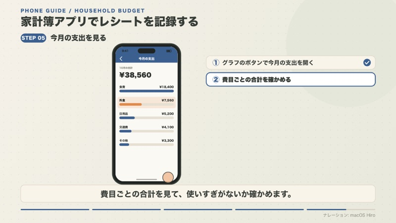
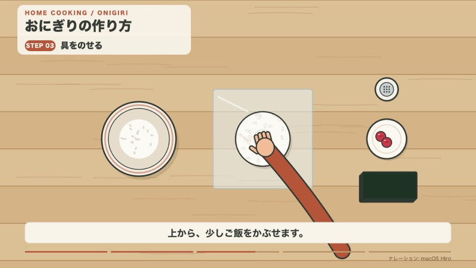
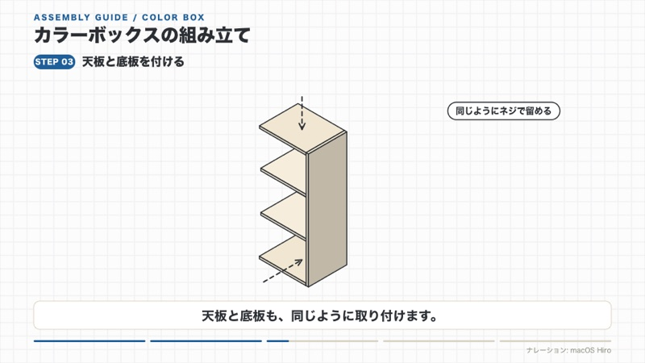
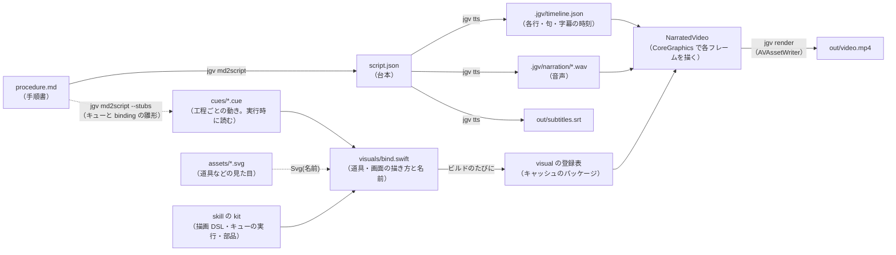
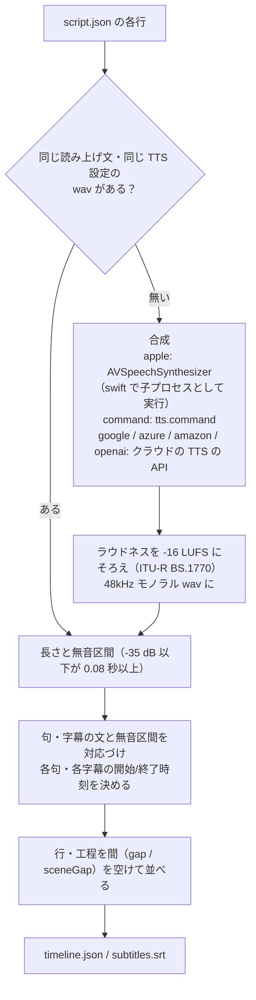
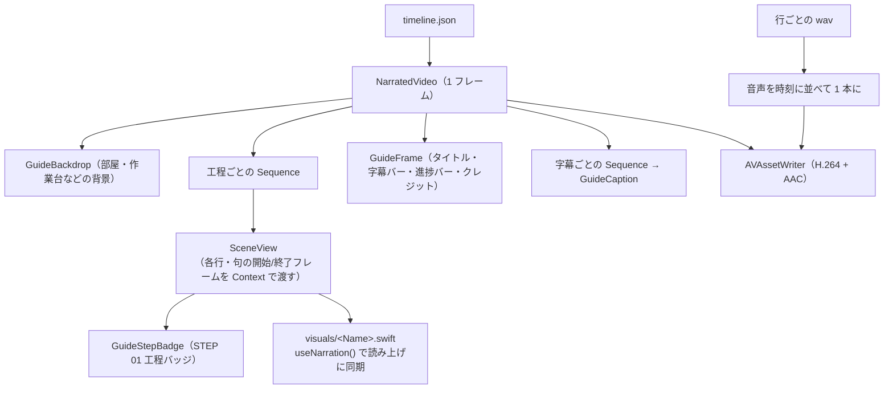
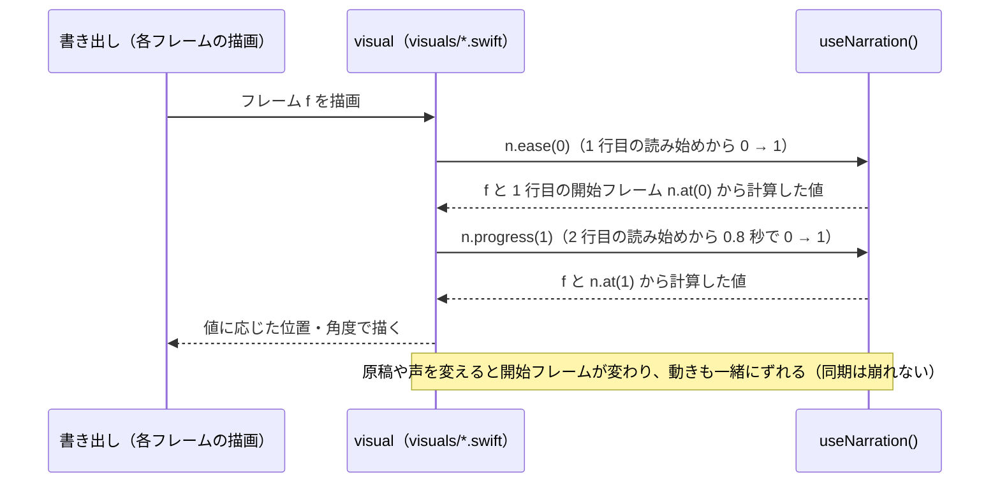

# j-swift-guide-video

> 名前の対応: リポジトリ `j-swift-guide-video` / skill `j-guide-video` / plugin `jgvs` / marketplace `junara-swift-skills` / CLI `jgv`

[](LICENSE)

> **English summary**: A Claude Code skill that turns a Markdown procedure into an illustrated, narrated how-to video (MP4) with subtitles — drawn with CoreGraphics and written with AVFoundation, Swift only (no Node.js / ffmpeg). **macOS only** (tested on Apple silicon; Intel Macs untested); use the latest Xcode / Command Line Tools (tested with Xcode 27.2, Swift 6.4 on macOS 27.2 — older versions are not tested). The default narration uses macOS system voices, which Apple's license limits to personal, non-commercial use; switch to a cloud TTS (Google / Azure / Amazon / OpenAI, built in) for public or business use. Docs are in Japanese; multilingual output (English, Chinese, Vietnamese, …) is supported. Install in Claude Code with `/plugin marketplace add junara/j-swift-guide-video` then `/plugin install jgvs@junara-swift-skills`. **Video projects contain code (Swift visuals, `tts.command`)**: running `jgv` on a project you did not create runs its code — see [SECURITY.md](SECURITY.md).

手順書（Markdown）から、**ナレーション（読み上げ音声）と字幕に同期して、画面全体が動くイラストの手順動画（MP4）** を作る Claude Code skill [`j-guide-video`](.claude/skills/j-guide-video/SKILL.md) のリポジトリです。「この手順書をイラストの手順動画にして」と Claude Code に頼むと、台本づくり・音声合成・アニメーション・書き出しまでを Claude が進めます。

- **Swift だけで動く**: 描画は CoreGraphics、読み上げは AVSpeechSynthesizer、書き出しは AVAssetWriter。Node.js・ffmpeg・ブラウザは使いません
- **5 種類の型**: 部屋（人物が道具で作業）・画面操作（スマホ・ブラウザ）・手元俯瞰・組み立て説明書・縦型（[型](#型)）
- **字幕と多言語**: SRT 字幕ファイルも同時に出力し、英語・中国語などの多言語版を一括で書き出せます
- **macOS 専用**: Mac 上の Claude Code で動きます（動作確認は Apple シリコン。[動作環境](#動作環境)）

| 部屋 | 画面操作 |
|---|---|
|  |  |
| **手元俯瞰** | **組み立て説明書** |
|  |  |


（デモ動画から取り出した静止画。デモ 10 本は [demo/](demo/README.md)）

> [!IMPORTANT]
> ナレーションは既定では macOS の音声で作るので、**書き出した動画は個人的・非商用の利用に限られます**。商用で使える TTS（組み込みの [Google Cloud Text-to-Speech](#google-cloud-text-to-speechengine-google)・[Azure AI Speech](#azure-ai-speechengine-azure)・[Amazon Polly](#amazon-pollyengine-amazon)・[OpenAI](#openaiengine-openai) や、[コマンドでつなぐ](#tts-エンジン)ほかの TTS）を使うと、その TTS の利用規約の範囲で使えます。詳しくは[生成した動画の利用条件](#生成した動画の利用条件)。

> [!NOTE]
> 動画のプロジェクトは Swift のコード（`visuals/*.swift` など）と `tts.command` のコマンドを含みます。**他人から受け取ったプロジェクトで `jgv` を実行するのは、そのコードを実行するのと同じ**です。有料のクラウドの TTS は、プロジェクトごとに `jgv tts --allow-cloud` で認めるまで呼びません。詳しくは [SECURITY.md](SECURITY.md)。

## 目次

- [こんな用途に](#こんな用途に)
- [動作環境](#動作環境)
- [クイックスタート](#クイックスタート)
- [生成した動画の利用条件](#生成した動画の利用条件)
- [インストール](#インストール)
- [型](#型)
- [CLI を手動で使う](#cli-を手動で使う)
- [ユーザーのライブラリ](#ユーザーのライブラリ)
- [TTS エンジン](#tts-エンジン)
- [コマンド一覧](#コマンド一覧)
- [しくみ](#しくみ)
- [動画のプロジェクトの中身](#動画のプロジェクトの中身)
- [リポジトリの構成](#リポジトリの構成)
- [開発者向け](#開発者向け)
- [ライセンス](#ライセンス)

## こんな用途に

- 料理・家事・掃除・家電の手入れなど、暮らしの「やり方」「作り方」を、部屋で人物が作業するイラストで見せたい
- アプリや Web サービスの操作手順を、スマホ・ブラウザの画面のタップ・クリックで見せたい
- 家具の組み立てや機器の設置を、説明書風の線画と矢印で見せたい
- 手順書はあるが、撮影・編集・ナレーションの収録をせずに動画にしたい
- 同じ動画の英語・中国語・ベトナム語版などをまとめて作りたい

## 動作環境

**macOS 専用**です。動作を確認した環境だけを対象にしています。

| 項目 | 要件 |
|---|---|
| OS | 最新の Xcode が動く macOS（`jgv` は macOS 14.5 より古いと止まる）。動作確認は Apple シリコンのみ。動作確認: macOS 27.2。Linux・Windows（WSL2 を含む）は非対応。Intel Mac は動作未確認 |
| 製品 | macOS 上の [Claude Code](https://claude.com/claude-code)（CLI・デスクトップアプリ・IDE 拡張）。Claude Code on the web、Claude.ai や Claude API のスキル実行環境は非対応 |
| コマンド | `bash`、最新の Xcode か Command Line Tools（`swift`。`xcode-select --install`）。動作確認: Xcode 27.2・Swift 6.4。古い版は確かめていない（Swift 6.0 より古いと `bin/jgv` が止まる）。Node.js・npm・ffmpeg は不要 |
| TTS（読み上げ音声） | 既定は macOS の音声（AVSpeechSynthesizer）。クラウドの TTS（Google・Azure・Amazon・OpenAI）を組み込みで使え、ほかの TTS もコマンドでつなげる（[TTS エンジン](#tts-エンジン)） |
| ネットワーク | 初回の CLI（`jgv`）のビルドで swift-argument-parser を取得するときだけ（クラウドの TTS を使うときを除く）。動画のプロジェクトは外部のパッケージを使わない |
| ディスク | CLI のビルド約 200 MB（`~/Library/Caches/j-guide-video/`）、動画のビルドのキャッシュ約 150〜200 MB（全プロジェクトで共有。古いものは `jgv clean --stale` で消せる） |

## クイックスタート

1. Claude Code の中で plugin を入れます（Claude Code 2.1.275 以降。古い版や clone して使う方法は[インストール](#インストール)）

   ```
   /plugin install jgvs --marketplace junara/j-swift-guide-video
   ```

2. Claude Code を開き、skill を呼ぶか、作りたい動画を言葉で頼みます。手順書は Claude が Markdown にまとめ直すので、題材を伝えるだけでも始められます

   - 手順動画: `/jgvs:j-guide-video`（plugin で入れた場合。このリポジトリの中やコピーで入れた場合は `/j-guide-video`）、または「この手順書をイラストの手順動画にして」「カレーの作り方を、人物が作業する動画にして」
   - 型を指定する: 「このアプリの操作手順を画面操作の動画にして」「家具の組み立てを説明書風の動画にして」「縦型で」
   - 多言語版: 「英語と中国語とベトナム語の版も作って」

3. Claude が次の流れで動画（`out/video.mp4`）と字幕（`out/subtitles.srt`）を書き出します

   1. 手順書を Markdown（`procedure.md`）にまとめ、雛形のプロジェクトを作成
   2. 手順書を `script.json`（台本）に変換し、キューの雛形を生成して音声を作成
   3. 道具・画面の描き方と名前（binding、`visuals/bind.swift`）を決める
   4. 工程ごとの動きを、句ごとに 1 行のキュー（`cues/<工程>.cue`）で書き、`jgv check`（手の時刻表・工程の境目・問題を文字で返す）で直す
   5. 各行のスナップショット一覧で見た目を確認・修正 → レンダリング

初回は CLI（`jgv`）を Swift でビルドするので、数十秒〜数分かかります。

## 生成した動画の利用条件

- **macOS の音声**: Apple の macOS ソフトウェア使用許諾契約（「Voices」の項。手元の macOS では `/Library/Documentation/License.lpdf` で読めます）では、システムの音声を使えるのは、自分のオリジナルの作品を個人的・非商用に作る場合だけです。営利・非営利・公開共有・商用の場での録音・公開・再配布は許されていません。既定のナレーションは macOS の音声なので、**書き出した動画は個人的・非商用の利用に限られます**。SNS・動画サイトへの公開や、仕事・会社での利用（社内向けのマニュアルも含まれると読めます）には使えません。
- **クラウドの TTS（Google・Azure・Amazon・OpenAI）・コマンドでつないだ TTS**: その TTS の利用規約に従います。商用で使える TTS を使えば、公開や仕事にも使えます。クレジットや AI 音声であることの表示が必要なら、`script.json` の `credit` に書きます。

この節は利用条件の要約で、法的な助言ではありません。詳しくはそれぞれの原文を確認してください。

## インストール

### plugin として入れる

Claude Code の中で次を実行します（Claude Code 2.1.275 以降）。

```
/plugin install jgvs --marketplace junara/j-swift-guide-video
```

ターミナルから入れるなら `claude plugin install jgvs --marketplace junara/j-swift-guide-video` です（こちらは Claude Code 2.1.292 以降）。それより古い Claude Code では、marketplace を追加してから入れます。

```
/plugin marketplace add junara/j-swift-guide-video
/plugin install jgvs@junara-swift-skills
```

### 手元に clone して使う

skill を直しながら試すときや、plugin を使わずに入れるときは、このリポジトリを clone して次のどれかの方法で使います。

```bash
git clone https://github.com/junara/j-swift-guide-video.git
```

- **このリポジトリの中で使う**: このフォルダで Claude Code を開けば、インストールせずに `/j-guide-video` で使えます。skill を直しながら試すときもこの方法です
- **plugin として入れる**: このフォルダを marketplace として登録してから入れます（`<このフォルダ>` は絶対パス）。skill は `/jgvs:j-guide-video` で呼べます。このリポジトリで skill を直したら、`/plugin marketplace update junara-swift-skills` で読み込み直します

  ```
  /plugin marketplace add <このフォルダ>
  /plugin install jgvs@junara-swift-skills
  ```

- **skill のディレクトリをコピーする**: 全プロジェクトで使うなら `~/.claude/skills/` にコピーします（このリポジトリで skill を直したら、コピーし直します）

  ```bash
  mkdir -p ~/.claude/skills && cp -R .claude/skills/j-guide-video ~/.claude/skills/
  ```

### 更新

Claude Code の中で `/plugin marketplace update junara-swift-skills` を実行するか（marketplace と一緒に、そこから入れた plugin も更新されます）、ターミナルで `claude plugin update jgvs@junara-swift-skills` を実行し、`/reload-plugins` か Claude Code の再起動で読み込み直します。この marketplace の自動更新は既定でオフです（`/plugin` の Marketplaces タブで有効にできます）。

> [!NOTE]
> 版が 0.x の間は、kit の部品・キューの文法・CLI のオプション・台本とプロジェクトの形式が、予告なく変わることがあります。更新すると、前に作った動画のプロジェクトがそのままではビルドできなくなることがあります（変わった点は [CHANGELOG.md](CHANGELOG.md) の「互換性の無い変更」に書きます）。見た目やコードを変えたくないプロジェクトは、更新の前に `jgv vendor-kit` で kit を固定してください。

### 削除

Claude Code の中で `/plugin uninstall jgvs@junara-swift-skills` を実行します（ターミナルでは `claude plugin uninstall jgvs@junara-swift-skills`）。marketplace も要らなければ `/plugin marketplace remove junara-swift-skills` で外します（そこから入れた plugin も一緒に削除されます）。

ライブラリ（`~/.config/j-guide-video`）と作った動画のプロジェクトは、skill を外しても消えません。要らなければ手で削除します。

ビルドのキャッシュ（`~/Library/Caches/j-guide-video`。CLI と動画のビルドで約 400 MB〜。skill を更新するたびに古い版が残ると増える）も残ります。要らなければ、ターミナルで次を実行して消します（`J_GUIDE_VIDEO_CACHE` で置き場を変えた場合は、そのフォルダごとではなく、中の `build-*`・`shared-*`・`projects`・`avtts` だけを消します。専用のフォルダとは限らないため）。

```bash
rm -rf ~/Library/Caches/j-guide-video
```

skill を使い続けながら古い分だけを消すなら、`jgv clean --stale` を使います（[コマンド一覧](#コマンド一覧)）。plugin で入れた場合は `jgv` のパスが分かりにくいので、Claude Code に「jgv の古いキャッシュを消して」と頼むのが簡単です。

### CLI をターミナルで使う

CLI は skill の `bin/jgv` です。初回と skill を更新したときだけ、自分自身を Swift でビルドします（数十秒〜数分）。ターミナルで直接使うなら、パスを通すか alias を作ります（clone して使う場合は、clone したフォルダの `.claude/skills/j-guide-video/bin/jgv` を指します）。

```bash
alias jgv="$HOME/.claude/skills/j-guide-video/bin/jgv"
```

## 型

| 型 | 見た目 | 向いている内容 |
|---|---|---|
| ガイド・部屋（`"layout": "guide"`） | 部屋の背景に同じ人物が立ち、道具を持って作業する。左上にタイトルと `STEP 01` 工程バッジ、下部に字幕バー・進捗バー・クレジット | 飲み物・家事・家電の手入れ |
| ガイド・画面操作（`"guide-screen"`） | スマホ・ブラウザの画面をタップ・クリック・入力で操作。注目箇所以外を暗くし、右にポイントメモ | アプリ・Web サービスの操作手順 |
| ガイド・手元俯瞰（`"guide-topdown"`） | 真上から見た作業台に画面下から両手が伸びる | 料理・工作 |
| ガイド・組み立て説明書（`"guide-manual"`） | 白い方眼紙に線画の等角図、点線の矢印、ネジ締め、部品リスト | 家具の組み立て・機器の設置 |
| 縦型（どの型でも 1080×1920。動作確認は部屋型のみ） | 部屋型なら上に人物、カウンターの下に拡大カードを常設 | スマホの縦画面で見る短い小技・レシピ |

ガイドの型ごとに、次の部品を用意しています（詳細は [visual kit](.claude/skills/j-guide-video/reference/visual-kit.md)）。

| 型 | 主な部品 |
|---|---|
| 部屋 | 手の位置を渡すだけで腕が伸びる人物（`Presenter`）、やかん・急須・湯のみ・マグ・ドリップバッグなどの道具、蛇口・シンク・スポンジ・洗剤・雑巾・ゴミ袋・掃除機・コンロ・ノート PC・コンセントとプラグ・ブレーカーなどの家事の道具、鍋・フライパン・包丁・まな板・ボウル・計量カップ・おたま・菜箸・電子レンジ・炊飯器・冷蔵庫などの台所の道具、注ぐ動き（`pourFrom`）・プラグを抜き差しする動き（`unplug` / `plugIn`）、拡大カード（`CloseUp`、句ごとに ①②③ の小手順が切り替わる）、注ぐ液体・湯気・注釈・チェックマーク、上から置かれる道具・水面の波紋・禁止マーク・円弧タイマー、人物の笑顔 |
| 画面操作 | スマホ／ブラウザの枠、指のタップ・カーソル、注目箇所以外を暗くする `Spotlight`、右側の `StepNotes`、アプリ画面の UI 部品（ボタン・入力欄・一覧・通知）、設計座標から画面座標への変換（`phoneSpace` / `browserSpace`） |
| 手元俯瞰 | 真上から見た手（`TopHand`）、ボウル・皿・塩入れ、ふりかけた粒、まな板・包丁・野菜（刻む動き `chop`）・フライパン |
| 組み立て説明書 | 等角図の板（`IsoBox`）、点線の矢印・回転の矢印、部品記号・部品リスト、ネジとドライバー |
| どの型でも | よくあるシーンの型: 用意するもの（`PrepareItems`）、注意点のカード（`NoteCards`）、ビフォー・アフター（`BeforeAfter`）、まとめのチェックリスト（`SummaryList`） |

道具の一覧は [props-catalog.png](.claude/skills/j-guide-video/reference/props-catalog.png)。題材に合う道具が無いときは、[prop-style.md](.claude/skills/j-guide-video/reference/prop-style.md) のルール（輪郭線・配色・原点）で Claude が同じタッチの道具を描き足します。

## CLI を手動で使う

Claude に頼まず、ターミナルから `jgv` を直接使うこともできます（パスの通し方は [CLI をターミナルで使う](#cli-をターミナルで使う)）。型ごとの完成例は [examples/](.claude/skills/j-guide-video/examples/README.md) にあります。

1. 手順書から動画のプロジェクトを作ります（`jgv init` → `jgv md2script --stubs visuals` → `jgv tts` をまとめて行い、キューを書くための時刻の表を出します）

   ```bash
   jgv new my-guide procedure.md --layout guide-screen
   ```

2. `visuals/bind.swift`（道具・画面の描き方と名前）と `cues/*.cue`（工程ごとの動き）を書きます（[キューの書き方](.claude/skills/j-guide-video/reference/cue.md)）
3. 確認してから書き出します

   ```bash
   cd my-guide && jgv dev && jgv render
   ```

- 手順書（`my-guide/procedure.md`）は `# タイトル` / `## 工程名 [tag]` / 本文（そのまま読み上げる文章）の Markdown。`[tag]` はアニメーション名になる
- `--layout` は `guide`（部屋）/ `guide-screen` / `guide-topdown` / `guide-manual`、縦型は `--vertical`、左上のシリーズ名は `--kicker`
- 読み上げをクラウドの TTS にするなら `--tts google` / `--tts azure` / `--tts amazon` / `--tts openai`、コマンドでつないだ TTS にするなら `--tts command`（[TTS エンジン](#tts-エンジン)）
- `--lang` は `ja-JP` / `en-US` のように地域まで書きます（`en` だけなら `en-US` に補います）
- `script.json` を直したら `jgv tts` で timeline を作り直します（`jgv dev` は自動で行います）。作り直さずに `jgv render` すると、古い台本のままにならないよう止まります
- 読み上げだけで伝えるなら `--no-text`（字幕バーと説明文＝注釈・ポイントメモ・拡大カードの小手順ラベルを出さない）。片方だけなら `--no-captions` / `--no-notes`
- `--stubs` でキューの雛形（`cues/<工程>.cue`・`visuals/bind.swift`）ができるので、すぐに最後まで書き出せる。binding に道具を、キューに句ごとの動きを書き足していく

### 多言語版

1. 画面上の文字はキューで `say 点 $キー:既定の文` のように書き（Swift の visual なら `n.t("キー", "既定の文")`）、`script.json` の `"strings"` に入れる
2. 言語ごとの手順書から、基準の台本の構成を引き継いで変換し、`strings` を翻訳する

   ```bash
   cd my-guide && jgv md2script procedure.zh.md -o script.zh.json --lang zh-CN --base script.json
   ```

3. まとめて書き出す（`out/video.mp4`、`out/video.zh.mp4` …）

   ```bash
   cd my-guide && jgv build-langs
   ```

声（その言語でインストール済みの最高品質の macOS の声。例: 英語 Samantha、中国語 Tingting）とフォントは言語に合わせて自動で切り替わります。言語によって文や読点の数が違っても、書き出しは止まりません。詳しくは [multilang.md](.claude/skills/j-guide-video/reference/multilang.md)。

## ユーザーのライブラリ

作った道具・動きと好みの設定を `~/.config/j-guide-video/`（`XDG_CONFIG_HOME` があればその下。環境変数 `J_GUIDE_VIDEO_LIBRARY` で変更、空文字で無効）に残し、次の動画で使い回します。skill の外にあるので、skill を更新しても消えません。

- `parts/*.swift` … 自作の道具・動き。プロジェクトを作るとき `parts/` にコピーされ、visual からそのまま `Steamer(x: …, y: …)` のように呼べます
- `defaults.json` … kicker・型・配色・声・速さ・字幕と説明文の表示の既定値（`jgv md2script` が使う。`--no-library` で使わない）

動画を書き出すと、Claude が保存する候補を挙げて、保存するかを聞きます。詳しくは [library.md](.claude/skills/j-guide-video/reference/library.md)。

## TTS エンジン

`script.json` の `tts.engine` で選びます。台本を作るときに `jgv md2script` の `--tts` で指定するか、作った `script.json` の `tts` を書き換えます。

### macOS の音声（`"engine": "apple"`、既定）

macOS の AVSpeechSynthesizer で読み上げます。`"voice": "auto"` で、台本の `lang` でインストール済みの最高品質の音声を自動で選びます（日本語の Sakura などのプレミアム/ニューラル音声は、ダウンロードしたときだけ使えます。無ければ Kyoko などの標準の声になります）。

macOS の声で書き出した動画は、個人的・非商用の利用に限られます（[生成した動画の利用条件](#生成した動画の利用条件)）。商用で使える高音質の声が必要なら、組み込みのクラウドの TTS（Google Cloud Text-to-Speech・Azure AI Speech・Amazon Polly・OpenAI）か、「コマンドでつなぐ」でほかの TTS を使います。

#### 高音質の声を使う

1. 「システム設定 > アクセシビリティ > 読み上げコンテンツ > システムの声 > 声を管理」から、日本語の拡張（Enhanced）またはプレミアムの声（Sakura など）をダウンロードする
2. 使える声を品質の高い順に確かめる（英語なら `jgv voices en-US`）

   ```bash
   jgv voices
   ```

3. 動画のプロジェクトで音声を作り直す。`"voice": "auto"` なら、ダウンロードした声が自動で選ばれる（音声のキャッシュは実際に選ばれた声もキーに含めるので、声が変わると全部の行を作り直す）

   ```bash
   jgv tts
   ```

- 特定の声に決めるときは、`jgv voices` に出る identifier を `tts.voice` に書く
- 速さは `rate`（0.0〜1.0、既定 0.5）、高さは `pitch`（0.5〜2.0、既定 1.0）で変える

```json
"tts": { "engine": "apple", "voice": "auto", "rate": 0.5, "pitch": 1.0 }
```

### コマンドでつなぐ（`"engine": "command"`）

`tts.command` に書いたコマンドを 1 行ごとに実行して音声を作ります。ElevenLabs などの API を呼ぶ小さなスクリプトを用意すれば、どの TTS でも使えます（Google・Azure・Amazon・OpenAI は、次の組み込みの engine を使えばスクリプトは要りません）。

```json
"tts": { "engine": "command", "command": ["swift", "/Users/me/.config/j-guide-video/tts-mytts.swift"], "voice": "my-voice" }
```

- 引数の `{text}`（読み上げる文）・`{out}`（書き出す音声ファイル）・`{lang}`・`{voice}` が置き換わり、同じ値が環境変数 `TTS_TEXT` / `TTS_OUT` / `TTS_LANG` / `TTS_VOICE` にも入ります（文が `-` で始まるとオプションと取り違えるコマンドでは、`--` の後に `{text}` を置くか、`TTS_TEXT` で受け取ります）
- ユーザーのライブラリの `defaults.json` に `"tts": { "engine": "command", "command": [...] }` と書くと、次の動画から使われます（いつもは macOS の音声で、ときどき使うなら `"engine"` を書かずに、使うときだけ `jgv md2script` に `--tts command` を付けます）。1 本だけなら、作った `script.json` の `tts` を書き換えます
- 句の区切りは音声の無音から求めるので、どの TTS でも字幕と動きが合います
- `tts.command` は書かれたコマンドをそのまま実行します。同じように `visuals/*.swift` もビルドして実行するので、**他人の動画のプロジェクト（台本・visual）を開いて `jgv tts` / `jgv dev` / `jgv render` を実行するのは、そのコードを実行するのと同じ**です。信頼できるものだけを使ってください

書き方の詳細とスクリプトの例は [environment.md の「TTS エンジン」](.claude/skills/j-guide-video/reference/environment.md#tts-エンジン) にあります。

### Google Cloud Text-to-Speech（`"engine": "google"`）

[Google Cloud Text-to-Speech](https://cloud.google.com/text-to-speech) で読み上げます。API キーを環境変数に設定するだけで使えて、スクリプトは要りません。使った分の料金がかかるので、[料金](https://cloud.google.com/text-to-speech/pricing)と利用規約を確かめてください。

1. [Google Cloud コンソール](https://console.cloud.google.com/)で、プロジェクトに課金を設定し、「Cloud Text-to-Speech API」を有効にする
2. 「API とサービス > 認証情報 > 認証情報を作成 > API キー」でキーを作る。キーの制限で、使える API を Cloud Text-to-Speech API だけにしておく
3. キーを環境変数 `GOOGLE_TTS_API_KEY` に設定する。エディタで `~/.zshrc` を開いて次の 1 行を書き足し、新しいターミナルを開く（`echo … >> ~/.zshrc` のようにコマンドで書くと、キーがシェルの履歴に残ります）

   ```bash
   export GOOGLE_TTS_API_KEY="ここに API キー"
   ```

   API キーの代わりに、サービスアカウントの鍵も使えます。「IAM と管理 > サービスアカウント」でサービスアカウントを作り、「鍵 > 鍵を追加 > 新しい鍵を作成 > JSON」で鍵をダウンロードして、そのパスを `GOOGLE_APPLICATION_CREDENTIALS` に設定します（両方あれば API キーを使います。gcloud は要りません）。組織のポリシー（`iam.disableServiceAccountKeyCreation`）で鍵を作れないときは、API キーを使うか管理者に相談してください。鍵のファイルは人に渡したり、リポジトリに入れたりしないでください。`jgv tts` は最初に、どのサービスアカウントで呼ぶか（料金がかかるプロジェクト）を表示します

   ```bash
   export GOOGLE_APPLICATION_CREDENTIALS="/path/to/service-account-key.json"
   ```

4. 使える声を確かめる（英語なら `jgv voices en-US --google`）

   ```bash
   jgv voices --google
   ```

5. 台本を作るときに `--tts google` を付ける。作った `script.json` の `tts` を書き換えてもよい（多言語版は、`--tts` も defaults.json の `tts.engine` も無ければ `--base` の台本の engine を引き継ぐので、ほかの言語も google になります）

   ```bash
   jgv md2script procedure.md --tts google
   ```

   ```json
   "tts": { "engine": "google", "voice": "ja-JP-Neural2-B" }
   ```

| 設定 | 内容 |
|---|---|
| `voice` | 声の名前（`jgv voices --google`）。書かなければ Google が台本の言語の既定の声を選びます（品質は声の種類によります。決まった声にしたいなら書きます） |
| `parallel` | 同時に合成する数（既定 2。429 のエラーが出たら下げる） |

### Azure AI Speech（`"engine": "azure"`）

[Azure AI Speech](https://learn.microsoft.com/azure/ai-services/speech-service/) の音声合成で読み上げます。キーと地域を環境変数に設定するだけで使えます。使った分の料金がかかるので、[料金](https://azure.microsoft.com/pricing/details/cognitive-services/speech-services/)と利用規約を確かめてください。

1. [Azure portal](https://portal.azure.com/) で「Speech」のリソース（Azure AI サービスの音声）を作る。地域は `japaneast` など
2. リソースの「キーとエンドポイント」で、キー（KEY 1）と場所/地域を控える
3. エディタで `~/.zshrc` に次の 2 行を書き足し、新しいターミナルを開く

   ```bash
   export AZURE_SPEECH_KEY="ここにキー"
   export AZURE_SPEECH_REGION="japaneast"
   ```

4. 使える声を確かめる（英語なら `jgv voices en-US --azure`）

   ```bash
   jgv voices --azure
   ```

5. 台本を作るときに `--tts azure` を付ける（`script.json` の `tts` を書き換えてもよい）

   ```json
   "tts": { "engine": "azure", "voice": "ja-JP-NanamiNeural" }
   ```

| 設定 | 内容 |
|---|---|
| `voice` | 声の名前（`jgv voices --azure`）。書かなければ、台本の言語の代表的な声（日本語は `ja-JP-NanamiNeural`、英語は `en-US-JennyNeural` など。一覧に無ければ名前の順で最初のニューラル音声）を選び、プロジェクトに覚えておいて次からも同じ声を使います |
| `parallel` | 同時に合成する数（既定 2） |

### Amazon Polly（`"engine": "amazon"`）

[Amazon Polly](https://aws.amazon.com/polly/) で読み上げます。AWS のアクセスキーと地域を環境変数に設定するだけで使えます。使った分の料金がかかるので、[料金](https://aws.amazon.com/polly/pricing/)と利用規約を確かめてください。

1. AWS の IAM で、Polly だけを使えるユーザーを作り、アクセスキーを作る。権限は次の 2 つで足ります

   ```json
   {
     "Version": "2012-10-17",
     "Statement": [{ "Effect": "Allow", "Action": ["polly:SynthesizeSpeech", "polly:DescribeVoices"], "Resource": "*" }]
   }
   ```

2. エディタで `~/.zshrc` に次の 3 行を書き足し、新しいターミナルを開く（一時的な認証情報なら `AWS_SESSION_TOKEN` も）

   ```bash
   export AWS_ACCESS_KEY_ID="ここにアクセスキー ID"
   export AWS_SECRET_ACCESS_KEY="ここにシークレットアクセスキー"
   export AWS_REGION="ap-northeast-1"
   ```

   `~/.aws/credentials` のプロファイルや SSO は読みません。AWS CLI v2 を使っているなら、`eval "$(aws configure export-credentials --format env)"` で今の認証情報を環境変数にできます

3. 使える声を確かめる（英語なら `jgv voices en-US --amazon`）

   ```bash
   jgv voices --amazon
   ```

4. 台本を作るときに `--tts amazon` を付ける（`script.json` の `tts` を書き換えてもよい）

   ```json
   "tts": { "engine": "amazon", "voice": "Kazuha", "pollyEngine": "neural" }
   ```

| 設定 | 内容 |
|---|---|
| `voice` | 声の名前（`jgv voices --amazon`）。書かなければ、台本の言語でその `pollyEngine` が使える代表的な声（日本語は `Kazuha`、英語は `Joanna` など。無ければ名前の順で最初の声）を選び、プロジェクトに覚えておいて次からも同じ声を使います。`neural` 以外の声は `jgv voices --amazon --polly-engine=generative` のように確かめます |
| `pollyEngine` | 声の種類。`neural`（既定）・`standard`・`long-form`・`generative`。使える声と地域は種類ごとに違います |
| `parallel` | 同時に合成する数（既定 2） |

### OpenAI（`"engine": "openai"`）

> [!WARNING]
> OpenAI は、この API で使えるモデル（`tts-1`・`tts-1-hd`・`gpt-4o-mini-tts`）を **2027 年 1 月 6 日に停止する予定**です（[OpenAI の廃止予定の一覧](https://developers.openai.com/api/docs/deprecations#2026-10-01-text-to-speech-models)）。後継のモデルはこの API では使えないので、停止後は google・azure・amazon などに切り替えてください。`jgv tts` も実行のたびに警告します

[OpenAI の音声合成](https://developers.openai.com/api/docs/guides/text-to-speech)で読み上げます。API キーを環境変数に設定するだけで使えます。使った分の料金がかかるので、[料金](https://openai.com/api/pricing/)と利用規約を確かめてください。

1. [OpenAI Platform](https://platform.openai.com/) で支払い方法を設定し、「API keys」でキーを作る
2. エディタで `~/.zshrc` に次の 1 行を書き足し、新しいターミナルを開く

   ```bash
   export OPENAI_API_KEY="ここに API キー"
   ```

3. 声の名前を確かめる（OpenAI には声の一覧を返す API が無いので、決まった一覧を出します）

   ```bash
   jgv voices --openai
   ```

4. 台本を作るときに `--tts openai` を付ける（`script.json` の `tts` を書き換えてもよい）

   ```json
   "tts": { "engine": "openai", "voice": "coral", "instructions": "落ち着いた声で、はっきり読む" }
   ```

| 設定 | 内容 |
|---|---|
| `voice` | 声の名前（`jgv voices --openai`）。書かなければ、OpenAI が勧める `marin`（`tts-1` / `tts-1-hd` では `alloy`） |
| `model` | モデル。`gpt-4o-mini-tts`（既定）・`tts-1`・`tts-1-hd` など |
| `instructions` | 話し方の指示（口調・速さ・感情など）。`gpt-4o-mini-tts` で使えます（`tts-1` / `tts-1-hd` では使えません） |
| `parallel` | 同時に合成する数（既定 2） |

- 言語は文から自動で判断されます。どの声も、どの言語でも読めます
- OpenAI の利用規約では、聞く人に AI が作った音声であることを伝える必要があります。そのため、クレジットの既定に「ナレーション: AI 音声 (OpenAI)」を出します（変えるなら `script.json` の `credit` に書きます）
- 残高や利用上限が尽きたエラー（429 の insufficient_quota）は、やり直さずにすぐ止まります

### クラウドの TTS に共通のこと

`google`・`azure`・`amazon`・`openai` に共通です。

- **料金がかかるので、プロジェクトと engine ごとに一度 `jgv tts --allow-cloud` で認めるまで呼びません**（`jgv tts` が合成する行数と字数を出して止まります。`jgv tts` が自動で読む声の一覧の API も、認めるまで呼びません。`jgv voices --google` などで自分から一覧を頼んだときはすぐ呼びます）。`jgv new --tts …` と、ライブラリの `defaults.json` の engine で `jgv new` した台本は、自分で選んだものとして自動で認めます。他人から受け取ったプロジェクトの `script.json` の `tts.engine` だけで、手元の API キーが送られたり料金がかかったりすることはありません（認めた印はキャッシュに置き、`jgv clean` でも消えません）
- いつも使うなら、ユーザーのライブラリの `defaults.json` に `"tts": { "engine": "azure" }` のように書きます。声は `voices` の中の engine の名前（`google` / `azure` / `amazon` / `openai`）に言語ごとに書きます（`voices` の直下の声は macOS の音声と `command` 用で、クラウドの TTS では使いません）

  ```json
  {
    "tts": { "engine": "azure" },
    "voices": {
      "google": { "ja-JP": "ja-JP-Neural2-B" },
      "azure": { "ja-JP": "ja-JP-NanamiNeural", "en": "en-US-JennyNeural" },
      "amazon": { "ja-JP": "Kazuha" }
    }
  }
  ```

- 多言語版（`--base`）は、`--tts` も defaults.json の `tts.engine` も無ければ、基準の台本の engine を引き継ぎます
- 生成した音声はキャッシュされ、文と `tts` の設定が変わった行だけ API を呼びます（すべてキャッシュにあれば、キーが無くても作り直せます。ただし azure / amazon で `voice` を書かず、まだ声を覚えていない（`.jgv/narration/.default-voices.json` が無い）ときは、声を選ぶために一覧の API を呼ぶのでキーと `--allow-cloud` の同意が要ります）
- 使わなくなった音声も消さずに残します（多言語版で、ほかの言語の台本の音声を消して API を呼び直さないように。macOS の音声だけは、作り直しが無料なので消します）。容量を空けたいときは `.jgv/narration/` を消します（次の `jgv tts` で全行を作り直します）
- 同時接続の上限のエラー（429）・サーバーのエラー（5xx）と、接続できなかったときは、少し待って 3 回までやり直します。続くようなら `parallel` を下げます。合成のリクエストを送った後のタイムアウト・切断は、料金が重ならないようやり直しません（`jgv tts` をもう一度実行すると、できた行はキャッシュを使います）
- 読み上げる文が空の行があると、API を呼ぶ前に止まります
- クレジットは自動では出ません（`jgv tts` が警告します。openai だけは「AI 音声 (OpenAI)」を出します）。表記が必要なら `script.json` の `credit` に書きます

## コマンド一覧

`jgv` のサブコマンドです（`new` / `init` / `md2script` / `api` / `voices` / `clean --stale` 以外は、動画のプロジェクトの中で実行します。`brief` / `overview` は引数でプロジェクトのディレクトリを渡してもよい）。引数とオプションは `jgv help <サブコマンド>`（または `jgv <サブコマンド> --help`）で出ます。知らないオプションはエラーになります（打ち間違えたサブコマンドやオプションには、近い名前を出します）。`jgv` だけを実行すると短い使い方を、`jgv --help` でサブコマンドの一覧と例を出します。`jgv --version` で skill の版を出します。

結果（表・一覧・書き出したファイル）は stdout に、進み具合・補足・警告は stderr に出します。`jgv render` の進み具合は、端末では同じ行を書き換え、端末でない（ログやパイプに流す）ときは 10 秒ごとに 1 行ずつ出します。終了コードは、成功が 0、失敗が 1、引数の誤りが 64 です。

| コマンド | 内容 |
|---|---|
| `jgv new <dir> [procedure.md]` | `jgv init` → `jgv md2script --stubs visuals` → `jgv tts` をまとめて行い、キューの時刻の表を出す（オプションは `jgv md2script` と同じ） |
| `jgv timing [台本]` | キューの時刻の表（工程ごとの `行.句` と、工程の始まりからの秒）を出す（`--json` で JSON。台本を渡すと先にその台本で `jgv tts` をする。timeline もその台本のものになる） |
| `jgv init <dir>` | 動画のプロジェクト（`jgv.json`・`visuals/`）を作る。ユーザーのライブラリの部品を `parts/` にコピー |
| `jgv md2script` | Markdown の手順書 → `script.json`（`-o` / `--output` で書き出す台本。`--stubs` でキューと binding の雛形も作る。`--swift-stubs` を足すと Swift の仮の visual） |
| `jgv check` | キューの工程ごとに、手の時刻表・始まりと終わりの状態・問題と、工程の境目の違いを文字で出す。文字・注釈・枠（字幕バーなど）の重なりと画面からのはみ出しも出す（画像を見る前に直す。問題があれば終了コード 1。`--json` で JSON） |
| `jgv api [語]` | kit とプロジェクトの `parts/` の関数・定数・型を、宣言と説明で引く（例: `jgv api やかん`。語が無ければ名前の一覧。`--json` で JSON） |
| `jgv tts [台本]` | 音声生成、タイムライン（`.jgv/timeline.json`）・SRT の出力（`--allow-cloud` で、このプロジェクトで有料のクラウドの TTS を使うことを認める。一度でよい） |
| `jgv dev` | 直した後の確認をまとめて行う: `jgv tts`（変わった行だけ）→ ビルド → `jgv check`（問題があれば止まる）→ 前回から変わった工程だけ `jgv snapshots`。Read する画像を最後に出す（`--all` ですべて撮り直す） |
| `jgv snapshots` | 各行のアニメーションの静止画一覧 `out/snapshots/sheet.png` を作る（見た目の確認用。ビルドしてから描く）。`--scene=N` で N 番目の工程だけ（N は 0 始まり。STEP 01 は `--scene=0`。その工程の visual と補助ファイルだけでビルドするので、並列に作業中のほかの工程のファイルでは止まらない。出力は `out/snapshots/scene-N/`）。`--phrases` で句ごと（1 工程 = 1 段、左端と右端が工程の最初と最後）、`--seams` で工程の境目だけ（境目 1 つ = 4 コマ）、`--scene=N --at=1.5,2.3` で工程の始まりからの秒を指定して撮る。`--video=out/video.mp4` を付けると、描かずにその動画から抜き出す |
| `jgv render` | `out/video.mp4` を書き出す（`-o` / `--output` で出力先） |
| `jgv still --frame=N` | 1 コマだけを `out/still.png` に書き出す（`--scale=0.5` など。`-o` / `--output` で出力先） |
| `jgv yomi` | 日本語の台本の語ごとの読み（macOS の形態素解析による目安）と、誤読しやすい書き方の警告を出す（`jgv tts` の最後にも警告だけ出る） |
| `jgv preview` | この動画で描いた道具の見本（`PROPS_PREVIEW` など）を `out/preview.png` に並べる（形・大きさ・持つ位置の確認用） |
| `jgv voices` | 使える音声を品質の高い順に一覧（既定は日本語。`jgv voices en-US` など。`--google` / `--azure` / `--amazon` / `--openai` でクラウドの TTS の声） |
| `jgv build-langs` | `script.json` と `script.<言語>.json` をまとめて書き出す（多言語版。台本ごとに `jgv check` を通し、`!` があれば止まる。`--no-check` で飛ばす） |
| `jgv catalog` | kit の道具の一覧画像 `out/props-catalog.png` を作る（`-o` / `--output` で出力先） |
| `jgv brief [dir]` | 工程担当のサブエージェントが読む資料 `out/brief.md` を、型に合わせて作る（Swift の visual で書くとき） |
| `jgv overview` | 工程ごとのナレーション・visual・静止画と SVG の素材を 1 ページにまとめる（`out/overview.html`） |
| `jgv migrate` | 前の形式のプロジェクト（`Package.swift`・`Kit/`・`Sources/Video/` がある）を今の形式にする |
| `jgv vendor-kit` | skill の kit をプロジェクトの `kit/` に写して固定する（skill を更新しても見た目を変えたくないとき。`kit/` を消すと戻る） |
| `jgv open` | ビルド用のパッケージを Xcode で開く（補完を使って visual を書くとき） |
| `jgv clean` | このプロジェクトのビルドのキャッシュを消す（クラウドの TTS を認めた印は残す。skill の kit を使うプロジェクトでは、全プロジェクトで共有の kit のビルドも消すので、次のビルドは数十秒〜数分かかる。`--stale` でフォルダが無くなったプロジェクトの分・共有のビルドにする前の分・置き場の無くなった skill の分をすべて。plugin を更新して置き場が無くなった古い版の jgv のビルドも消える。`-n` / `--dry-run` で消さずに、消すものを出すだけ） |

## しくみ

### 全体の流れ

手順書から台本を作り、`jgv tts` で音声とタイムラインを、`jgv render` で動画を書き出します。動画のプロジェクトには題材ごとのファイル（台本・visual・SVG の素材）だけを置きます。`jgv render` / `jgv snapshots` は、キャッシュ（`~/Library/Caches/j-guide-video/`）の Swift のパッケージをビルドしてから描きます。パッケージの中身はシンボリックリンクで、skill の kit とプロジェクトの `visuals/` などを指します。パッケージは全プロジェクトで共有するので、kit のビルドは skill を入れた・更新した後の 1 回だけです（`jgv new`・`jgv init`・`jgv tts` が裏で先に済ませます）。



### 音声とタイムラインの生成（`jgv tts`）

台本の 1 行ごとに音声を作り、音声の無音区間から句の区切りを求めて、タイムラインと字幕を書き出します。



- 音声は読み上げ文（行の `speak`、無ければ `text`）と TTS 設定のハッシュをファイル名にしてキャッシュするので、原稿を一部直したときは変わった行だけ作り直します
- 句読点で終わる区切りは、文字数から見積もった時刻に近い無音へ順番どおりに合わせます（動的計画法）。無音に合わない区切り（字幕を文字数で分けた位置など）は、前後の確定した時刻の間を文字数の比率で埋めます。音声そのものから求めるので、どの TTS エンジンでも字幕と動きが読み上げに合います
- コンパイルしたバイナリからは macOS のプレミアム/ニューラル音声（Sakura など）が見えないので、合成の部分だけは `swift` コマンド（インタプリタ）で実行しています

### 動画の組み立て（`jgv render`）

`NarratedVideo` は `timeline.json` の時刻をフレームに直し、各フレームで背景 → 工程の visual と工程バッジ → 枠 → 字幕の順に描きます。フレームは CPU のコア数に合わせて並列に描き、AVAssetWriter で順番に H.264 にします。音声は各行の wav を行の開始時刻に並べて AAC にします。



visual は秒数ではなく「何行目（何句目）が読まれているか」で動きを決めます。`useNarration()` は毎フレーム、現在のフレームと各行・句の開始フレーム（工程の始まりからのフレーム）を比べて値を返します。



### 工程の動きの書き方（キュー）

工程の動きは、句ごとに 1 行のキュー（`cues/<工程>.cue`）で書きます。道具・画面の描き方と名前は、動画ごとに 1 回だけ binding（`visuals/bind.swift`）に Swift で書き、キューからは名前で指します。キューは実行時に読むので、直してもビルドし直しません。時刻は「何行目の何句目」で書くので、原稿や声を変えても同期が崩れません。

```
init <Load                                   # 前の工程の終わりの状態から始める
0.0+.3 H>mw.handle~.45                       # 行 0 句 0 の読み始め + 0.3 秒に、右手が取っ手に着く
0.0+.35 mw.open=0~.6                         # 扉を 0.6 秒で閉める (手は取っ手に付いていく)
0.2+.45 P mw.start;mw.on=1~.2;mw.disp=cd 2:00 0:00@1.0;timer timer 2分@1.0
1.1+.87 dish@PLATE~.7;steam dish.top         # お皿を取り出して置き場所へ、湯気
```

`jgv check` は工程ごとに、手の時刻表（何秒〜何秒に、どこからどこへ）・始まりと終わりの状態・問題（名前の誤り、手が遠い、つまんだ物を動かしている途中で手を離す など）と、工程の境目の違いを文字で返します。文法と binding の書き方は [cue.md](.claude/skills/j-guide-video/reference/cue.md)。

### Swift の visual の書き方

キューで書けない動きは Swift で書きます（binding の描き方の中、または工程全体を Swift の visual にする）。デモ 10 本は工程全体を Swift で書いています。

- **描画 DSL**: SVG の要素と属性をそのまま関数と引数にしたもの（`g(transform: [.translate(x, y)]) { … }`、`path("M 0 0 L …", fill: "#fff", stroke: palette.ink)`、`rect` `circle` `ellipse` `line` `polygon` `text`）。今の描画先とフレームはスレッドごとに持つので、部品は `Presenter(handR: …)` のように呼ぶだけで描けます
- **ナレーション同期**: visual の中で `useNarration()` を使うと、各行の読み上げ開始フレーム（`n.at(1)`）や進捗（`n.progress(0, 0.8)`）が取れます。秒数をベタ書きしないので、原稿や声を変えても同期が崩れません
- **工程の visual**: `visuals/<Name>.swift` に `func <Name>(_ props: Props)` を書くと `"visual": "<Name>"` で使えます（手順書の `## 工程名 [name]` から自動で割り当て）。人物・道具・拡大カード・画面操作などのガイド部品に加え、線で描く（`Draw`）、弾んで登場（`Pop`）、流れる点（`FlowDots`）、波紋（`Pulse`）、放射線（`Burst`）、カウントアップなどの部品を [visual kit](.claude/skills/j-guide-video/reference/visual-kit.md) にまとめています

```json
{
  "heading": "お湯を沸かす",
  "visual": "Boil",
  "lines": ["やかんに水を入れ、火にかけます。"]
}
```

```swift
// visuals/Boil.swift
import JGVKit

func Boil(_ props: Props) {
  let n = useNarration()
  let reach = n.ease(0)                                          // 1 行目の読み始めで手を伸ばす
  let handle = place(1100, GUIDE.counterY, 0.85, 0, KETTLE_PARTS.handle)
  Stage {
    Kettle(x: 1100, y: GUIDE.counterY, scale: 0.85)
    Steam(x: 1180, y: GUIDE.counterY - 220)                       // ずっと動く湯気
    Presenter(handR: mix(PRESENTER.gestureR, handle, reach))
  }
}
```

## 動画のプロジェクトの中身

`jgv new` で作るプロジェクトには、題材ごとに作るファイルと成果物だけが入ります。ビルドに使う Swift のパッケージと kit は入りません。

```
my-guide/
├── jgv.json            # プロジェクトの印（形式の版と、作ったときの skill の版）
├── procedure.md        # 手順書
├── script.json         # 台本（多言語版は script.<言語>.json）
├── cues/               # 工程ごとの動き（<工程>.cue。句ごとに 1 行のキュー）
├── visuals/            # binding（bind.swift）・キューを呼ぶ 1 行（<工程>.swift）・新しく描いた道具（props.swift など）
├── parts/              # ユーザーのライブラリの部品（jgv init がコピー。編集しない）
├── assets/             # 道具などの見た目の SVG（visual から Svg("名前") で描く）
├── kit/                # jgv vendor-kit で固定した kit（ふだんは無い）
├── out/                # video*.mp4・subtitles*.srt・overview.html・brief.md・snapshots/・preview.png
└── .jgv/               # 途中の生成物（timeline.json・narration/*.wav）
```

ビルド用のパッケージは `~/Library/Caches/j-guide-video/shared-<ハッシュ>/` に `jgv` が作り、全プロジェクトで共有します（約 150〜200 MB。`jgv vendor-kit` で kit を固定したプロジェクトだけは `projects/<プロジェクトのパスのハッシュ>/` に自分のパッケージを作ります）。kit は skill の版を参照するので、skill を更新すると次のビルドから新しい kit になります。前の形式のプロジェクト（`Package.swift`・`Kit/` を持つもの）は `jgv migrate` で今の形式にします。

## リポジトリの構成

```
.claude-plugin/                 # plugin.json（plugin の定義）と marketplace.json（/plugin install で入れるための一覧）
.github/workflows/ci.yml        # GitHub Actions（ビルド・単体テスト・examples の md2script）
CLAUDE.md                       # 開発ルール（Claude Code が読む）
CHANGELOG.md                    # 変更履歴
SECURITY.md                     # 安全のための決まり（他人のプロジェクトを開くときの考え方・API キーの扱い）
LICENSE                         # MIT
mise.toml                       # 開発用のツールの版（mise を使うときだけ）
.claude/skills/j-guide-video/
├── SKILL.md                    # skill 本体（手順書 → イラスト手順動画の手順）
├── LICENSE                     # MIT（skill だけをコピーしても付いてくるように同梱）
├── Package.swift               # Swift のパッケージ（CLI jgv と kit）
├── Tests/                      # 単体テスト（swift test。解析・検証・jgv clean --stale の安全）
├── bin/jgv                     # CLI の起動（初回と skill を更新したときだけ ~/Library/Caches/j-guide-video/ にビルドして実行）
├── Sources/
│   ├── JGVCore/                # 描画 DSL（SVG のパス・塗り・線・グラデーション・文字・変形・クリップを CoreGraphics で描く）、
│   │                           #   interpolate / spring / random、timeline の型、静止画・音声ファイルの読み書き
│   ├── JGVKit/                 # useNarration・motion・primitives・NarratedVideo・道具の一覧
│   │   └── guide/              # ガイドの型: Theme (配置・配色) / Chrome (背景・枠) / Presenter / Props / Household (家事の道具) /
│   │                           #   Kitchen (台所の道具) / Effects (共通の演出) / Scenes (よくあるシーンの型) / Screen / Topdown / Manual /
│   │                           #   Cue (キューと binding) / Assets (SVG の素材)
│   ├── JGVRender/              # 書き出し（AVAssetWriter で H.264 + AAC、フレームを並列に描く）、静止画の一覧、動画のプロジェクトの実行ファイルの入口
│   ├── JGVTools/               # md2script・tts（AVSpeechSynthesizer、ラウドネス正規化、無音検出）・yomi・brief・overview・init・migrate・
│   │                           #   ビルド（キャッシュのパッケージを作って swift build）・build-langs
│   └── jgv/                    # CLI（swift-argument-parser）
├── examples/                   # キューと binding で書いた型ごとの完成例
├── reference/
│   ├── cue.md                  # キュー（工程の動き）の文法と binding の書き方
│   ├── options.md              # jgv init / md2script / new のオプションの詳細（人物の見た目・--no-text・defaults.json との関係）
│   ├── visual-kit.md           # 描画 DSL・useNarration・部品・ガイドの型のリファレンス
│   ├── prop-style.md           # 新しい道具を同じタッチで描くルール
│   ├── props-catalog.png       # kit の道具の一覧画像
│   ├── implementation.md       # 型ごとの要点と、Swift の visual の実装ルール
│   ├── storyboard.md           # 工程ごとの絵コンテの書き方（Swift の visual で書くとき）
│   ├── rewriting.md            # 自由な文章から手順書に書き換える基準
│   ├── multilang.md            # 多言語版の作り方
│   ├── environment.md          # 動作環境の詳細
│   ├── tips.md                 # 実例・調整・トラブルシュート
│   ├── library.md              # ユーザーのライブラリ（自作の部品・既定値）の使い方と保存の手順
│   └── scene-agent.md          # 工程担当サブエージェントへの指示のテンプレート（Swift の visual で書くとき）
demo/                           # 台本（02〜10 は手順書も）+ カスタム visual のデモ 10 本 (02 は 5 言語版)。各デモのフォルダがそのまま動画のプロジェクト。run.sh でまとめて書き出す
docs/images/                    # README の静止画
```

## 開発者向け

- **issue と PR**: 個人で開発しているリポジトリなので、外部からの issue・PR・脆弱性の報告は受け付けていません（Issues と Pull requests は無効にしています）。直して使いたいときは、MIT License の範囲で fork してください
- **開発ルール**: [CLAUDE.md](CLAUDE.md)（変更をそろえる文書、テスト、セキュリティ、コミットしないもの）
- **デモを書き出す**: リポジトリのルートで `bash demo/run.sh` を実行します（1 本だけなら `bash demo/run.sh 05-budget-app-screen`）。詳しくは [demo/README.md](demo/README.md)
- **変更履歴とセキュリティ**: 利用者に見える変更は [CHANGELOG.md](CHANGELOG.md)、「他人のプロジェクト＝コードの実行」の考え方は [SECURITY.md](SECURITY.md)
- **テスト**: `.claude/skills/j-guide-video/` で `swift test`（解析・検証まわりの単体テスト）。GitHub Actions でも同じものを実行します
- **`mise.toml`**: [mise](https://mise.jdx.dev/) を使う開発者向けに Claude Code（`claude`）の版を入れるだけの設定です。skill の利用には要りません（API キーなどは `mise.local.toml` に書けば `.gitignore` で除外されます）
- **新しい版を出すとき**: ふだんの変更は [CHANGELOG.md](CHANGELOG.md) の「未リリース」にためます。リリースのときに [`.claude-plugin/plugin.json`](.claude-plugin/plugin.json) の `version`（今は 0.1.0）を上げ、`v0.1.0` のようなタグを打ちます（手順は [CLAUDE.md](CLAUDE.md) の「リリース」）。`version` を上げるまで、plugin で入れた利用者に更新は届きません

## ライセンス

[MIT License](LICENSE)。skill のフォルダ（`.claude/skills/j-guide-video/`）にも同じ LICENSE を同梱しています。CLI はビルドのときに [swift-argument-parser](https://github.com/apple/swift-argument-parser)（Apache License 2.0）を取得して使います。書き出した動画の利用条件は[生成した動画の利用条件](#生成した動画の利用条件)を確認してください。
